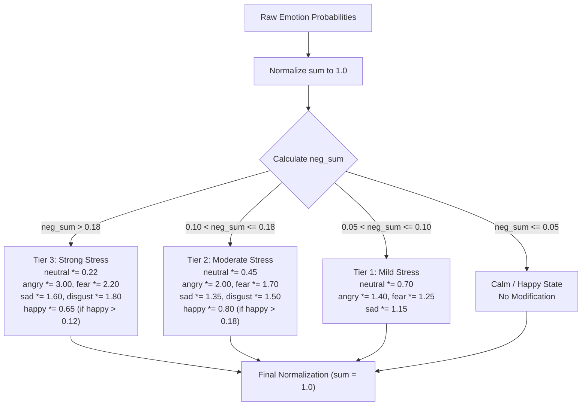
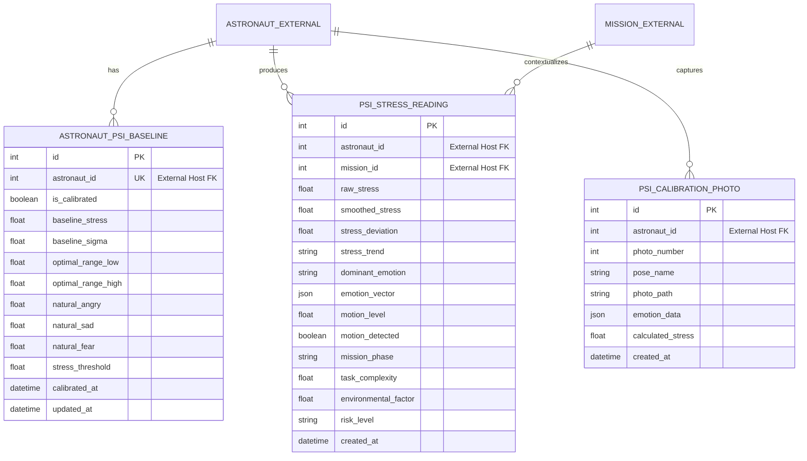

# ASTRA MIND: PSI STRESS-MONITORING MIGRATION AUDIT REPORT

**Project:** ASTRA MIND — Astronaut Behavioral Health Intelligence Platform  
**Target Migration:** Original PSI (Psychological Stress Index) v5 Engine (`fix_clean`) $\rightarrow$ ASTRA MIND Extension Architecture  
**Audit Date:** 2026-11-14  
**Author:** AI Technical Architecture & Audit Team  
**Status:** Audit Complete — Pending Implementation Approval  

---

## Executive Summary

This source code audit evaluates the feasibility, architectural alignment, mathematical fidelity, and integration path for transforming the standalone Psychological Stress Index (PSI) system (located in `D:\astra-mind-extension\fix_clean`) into the mission-critical **ASTRA MIND Astronaut Behavioral Health Intelligence Platform** (`D:\astra-mind-extension\astra-mind-extension`).

The original PSI application is a hybrid research/workplace monitoring tool built with Flask, SQLite, OpenCV, and DeepFace. It measures emotional stress from facial expressions, incorporates task complexity and physical motion, normalizes against an individualized resting baseline, and tracks chronic burnout indicators.

Our audit confirms that:
1. **Core Algorithms are Sound & Mathematically Complete:** The live PSI v5 calculation, neutral bias correction (`rebalance_emotions`), Valence-Arousal emotion mapping, IQR outlier removal, and personal baseline standard-deviation nudge are fully verified by a 10-module benchmark suite (`benchmark_psi.py`).
2. **Clean Separation of Concerns is Feasible:** Corporate HR/employee management, Jinja2 server-rendered HTML templates, direct webcam hardware capture loops on the host server, and administrative staff dashboards can be safely deprecated without impacting the stress-computation engine.
3. **ASTRA MIND Extension Alignment:** ASTRA MIND's architecture (FastAPI backend + SQLAlchemy 2.0 ORM + Vite/React frontend) is ready to absorb the PSI engine. Specifically, ASTRA MIND's interactive "Human Health Map" currently flags the `brain` body system as `grey` (indicating missing telemetry source). Ingesting PSI telemetry directly activates this cognitive and behavioral indicator system while preserving strict data integrity principles.

---

## 1. Original PSI Architecture

### 1.1 High-Level Architecture Overview

The original PSI application in `fix_clean` was designed as a local web-based workstation monitoring application:

```
+-----------------------------------------------------------------------------------+
|                            ORIGINAL PSI APPLICATION                               |
+-----------------------------------------------------------------------------------+
|  Presentation Layer (Flask + Jinja2 Templates)                                   |
|   - index.html, dashboard.html, staff_detail.html, monitor.html                   |
|   - capture.html (5-pose calibration), task_management.html, analytics.html       |
+-----------------------------------------------------------------------------------+
|  Application & API Layer (app.py)                                                 |
|   - Flask REST endpoints (/api/register, /api/analyze_frame, etc.)               |
|   - Multi-threaded camera acquisition (OpenCV VideoCapture on host index 0/1/2)   |
|   - In-memory monitoring state (current_monitoring dictionary)                    |
+-----------------------------------------------------------------------------------+
|  Analytical & Behavioral Core                                                     |
|   - research_monitor.py: Live PSI v5 calculation, rebalancing, motion detection   |
|   - emotion_analyzer.py: Dual-path vision (DeepFace primary + OpenCV stub)        |
|   - photo_capture.py: 5-photo acquisition & statistical baseline calculation     |
|   - monitoring.py: Legacy v1/v2 monitoring prototype (superseded by v5)           |
+-----------------------------------------------------------------------------------+
|  Persistence Layer (database.py)                                                  |
|   - SQLite (stress_monitor.db) with raw sqlite3 connections                       |
|   - Tables: staff, stress_readings, calibration_photos, task_assignments          |
+-----------------------------------------------------------------------------------+
```

### 1.2 Component Breakdown

1. **`app.py` (Flask Application Controller):**
   - Implements both server-rendered HTML views and JSON API endpoints.
   - Manages an in-memory `current_monitoring` state dictionary with camera handles and active monitor instances.
   - Provides two video streaming/analysis mechanisms:
     - *Server-side OpenCV loop (`monitoring_loop`):* Directly attempts to open host cameras via `cv2.VideoCapture` using backends `CAP_MSMF`, `CAP_DSHOW`, `CAP_ANY`.
     - *Browser-based frame analysis (`/api/analyze_frame/<staff_id>`):* Ingests base64-encoded JPEG frames captured via browser webcam APIs, executes face detection, periodic facial verification, and stress inference.

2. **`research_monitor.py` (Research-Grade Stress Engine - PSI v5 Final):**
   - Contains the authoritative mathematical model for PSI.
   - Houses the Russell (1980) Valence-Arousal circumplex emotion table (`EMOTION_DIMENSIONS`).
   - Implements `rebalance_emotions()`: a 3-tier neutral bias suppression and negative emotion amplification engine.
   - Implements `calculate_stress_from_emotions()`: multi-factor stress formula combining emotional arousal, happy/neutral inhibition factors, task complexity, motion dynamics, and Z-score personalized baseline stretching.
   - Contains `ResearchStressMonitor`: real-time session tracking class managing rolling smoothing windows, Gaussian blur frame-differencing for motion detection, and risk-tier categorization.

3. **`emotion_analyzer.py` (Computer Vision & Facial Affect Engine):**
   - Dual-path emotion extraction:
     - **Primary Path (DeepFace):** Wraps `deepface.DeepFace.analyze(actions=['emotion'])` with grimace-guard heuristic post-processing.
     - **Fallback Path (OpenCV Stub):** An engineered heuristic computer vision pipeline utilizing Haar cascades (`haarcascade_frontalface_default.xml`, `haarcascade_smile.xml`, `haarcascade_eye.xml`), 3-signal brow furrow detection (contrast, Sobel vertical gradient, Laplacian texture variance), 3-signal smile detection (cascade, cheek-raise luminance, corner brightness), eye aspect ratio, and bounded random-walk temporal smoothing.
   - Facial identity verification via `verify_face_against_photos()` using cosine/euclidean face embeddings.

4. **`photo_capture.py` (Calibration & Personal Baseline Calculation):**
   - Ingests 5 calibration photographs taken across different poses (Neutral, Left, Right, Smile, Neutral).
   - Filters out statistical outliers using interquartile range (IQR) trimming.
   - Calculates baseline stress ($\mu$) and standard deviation ($\sigma$).
   - Computes asymmetric optimal functioning stress bounds.

5. **`database.py` (SQLite Persistence Interface):**
   - Manages SQLite schema and queries via raw parameterized SQL.
   - Tracks staff members, calibration baselines, continuous stress readings, calibration photo metadata, and corporate task assignments.

6. **`monitoring.py` (Legacy v1/v2 Engine):**
   - An earlier iteration of the stress monitor utilizing a simplistic multiplicative formula (`raw_stress = emotional_stress * task_factor * motion_factor`).
   - *Status:* Superseded by `research_monitor.py` (PSI v5). Retained in `fix_clean` for historical reference, but marked legacy for migration.

7. **`benchmark_psi.py` (Validation Suite):**
   - Comprehensive test harness covering 10 benchmark dimensions (B1 to B10): canonical emotion vector accuracy, latency, EMA smoothing quality, determinism, baseline Z-score personalisation, Burnout Risk Score (BRS), extreme input safety, happy face suppression, task complexity lift, and chronic stress detection.

8. **`tests/` (Integration & DB Tests):**
   - `test_db_only.py`: Tests CRUD operations on SQLite without requiring graphical libraries or Flask.
   - `test_api_integration.py`: Validates Flask routes with temporary SQLite databases.

---

## 2. Reusable Source Files and Functions

### 2.1 Reusable Engine Functions (High Value)

The table below outlines the core functional assets to be extracted into the ASTRA MIND behavioral health service:

| Source File | Function / Class | Reusability Scope | Architectural Purpose in ASTRA MIND |
|---|---|---|---|
| `research_monitor.py` | `rebalance_emotions(emotions)` | **100% Direct** | Corrects DeepFace neutral inflation bias (calibrated tiers for real-world negative sums). |
| `research_monitor.py` | `calculate_stress_from_emotions(...)` | **100% Direct** | Core PSI v5 mathematical formula (valence-arousal, HIF, NIF, ABST, task, motion, baseline Z-score). |
| `research_monitor.py` | `calculate_emotional_stress(emotions)` | **100% Direct** | Calibration-phase stress computation (pure resting affect without task/motion bias). |
| `research_monitor.py` | `ResearchStressMonitor` class | **90% Adapted** | Session state management, frame differencing motion detection, rolling smoothing window, trend detection. |
| `emotion_analyzer.py` | `analyze_emotion_frame(frame, face_box)` | **100% Direct** | Unified emotion inference with automatic DeepFace $\rightarrow$ OpenCV fallback. |
| `emotion_analyzer.py` | `_stub_emotions(frame, face_box)` | **100% Direct** | Offline/air-gapped OpenCV fallback with 3-signal brow furrow, cheek-raise smile, and eye openness. |
| `emotion_analyzer.py` | `detect_face_box(frame)` | **100% Direct** | Bounding box locator for face tracking and frontend overlay alignment. |
| `emotion_analyzer.py` | `verify_face_against_photos(...)` | **100% Direct** | Biometric verification ensuring telemetry belongs to the designated astronaut. |
| `photo_capture.py` | `calculate_baseline_stress(...)` | **100% Direct** | IQR-trimmed mean baseline $\mu$, personal variability $\sigma$, asymmetric optimal zones $[low, high]$. |
| `photo_capture.py` | `save_web_photo(...)` | **90% Adapted** | Base64 decode and storage of calibration imagery. |
| `app.py` | `api_analytics_burnout_all()` logic | **100% Direct** | Burnout Risk Score: $BRS = 0.5 \cdot \text{avg} + 0.3 \cdot \sigma + 0.2 \cdot \text{task}$. |
| `app.py` | `api_analytics_chronic()` logic | **100% Direct** | Chronic stress detection: consecutive 7-day rolling window above $\text{baseline} + 15$. |
| `benchmark_psi.py` | Entire Benchmark Suite (B1-B10) | **100% Direct** | Mathematical calculation parity tests in pytest. |

### 2.2 Unnecessary Legacy Functionality (To Exclude)

The following components represent legacy corporate HR concepts or obsolete application patterns that **must not** be migrated:

1. **Corporate / Employee Management:**
   - Registration of corporate "staff" (`staff_id`, `department`, `email`).
   - Corporate hierarchy management (`/dashboard`, `/staff/<staff_id>`, `/delete/<staff_id>`).
   - Admin panel (`/admin`, `admin.html`).
   *Reason:* ASTRA MIND is designed for space missions. Personnel are identified via external `astronaut_id` referencing mission manifests.
2. **Corporate Task Management:**
   - Database table `task_assignments` and routes (`manage_tasks`, `/tasks/<staff_id>`).
   - HR-centric parameters: `deadline_urgency`, `skill_match`, `workload_size`, `interruption_level`.
   *Reason:* In mission environments, task context is derived from flight plans, EVA logs, robotics operations, and scheduled mission routines.
3. **Server-Side Host Webcam Ingestion (`monitoring_loop` / `cv2.VideoCapture`):**
   - Host-level camera acquisition threads attempting direct hardware access on server ports.
   *Reason:* Modern client-server architecture requires video frames to originate from the user's browser client via WebRTC/HTML5 Canvas and stream to the FastAPI backend.
4. **Flask Jinja2 HTML Templates & Monolithic Static Assets:**
   - `templates/*.html` (11 template files) and `static/css`.
   *Reason:* ASTRA MIND features a modern decoupled React application.
5. **Desktop Browser Automation:**
   - Python `webbrowser.open('http://localhost:5000')` startup routines.

---

## 3. Mathematical Methodology

The Psychological Stress Index (PSI v5) implements a rigorous multi-stage pipeline grounded in Russell's (1980) circumplex model of affect and psychophysiological stress dynamics.

### 3.1 Valence-Arousal Circumplex Dimensions

Every recognized emotion is mapped to a coordinate in 2D affective space: Arousal $A \in [0, 1]$ and Valence $V \in [-1, 1]$:

$$\text{Dimensions: } \{e: (A_e, V_e)\}$$

| Emotion | Arousal ($A$) | Valence ($V$) | Theoretical Stress Potential |
|---|---|---|---|
| **Angry** | 0.83 | -0.88 | Extremely High |
| **Fear** | 0.90 | -0.85 | Extremely High |
| **Sad** | 0.32 | -0.78 | Moderate-High (Low energy, negative valence) |
| **Disgust** | 0.55 | -0.70 | Moderate-High |
| **Surprise** | 0.78 | +0.10 | Moderate (Arousal dominant, positive/neutral valence) |
| **Neutral** | 0.12 | 0.00 | Low Baseline |
| **Happy** | 0.62 | +0.90 | Strong Stress Inhibitor |

Base stress weight is derived as:
$$W_e = \text{round}\left(A_e \cdot \max(0.0, -V_e), 3\right)$$
- Angry: $0.83 \times 0.88 = 0.730$
- Fear: $0.90 \times 0.85 = 0.765$
- Sad: $0.32 \times 0.78 = 0.250$
- Disgust: $0.55 \times 0.70 = 0.385$
- Surprise, Neutral, Happy: $0.000$ (negative valence is zero)

### 3.2 Emotion Normalization & Neutral Bias Correction

DeepFace exhibits a recognized systematic neutral inflation bias (classifying genuine anger or fear with 55%–70% neutral probability). To prevent false negatives, `rebalance_emotions()` applies a non-linear, multi-tiered redistribution:

Let probabilities be normalized such that $\sum_{e} p_e = 1.0$. Compute negative arousal sum:
$$\text{neg\_sum} = p_{\text{angry}} + p_{\text{fear}} + p_{\text{sad}} + p_{\text{disgust}}$$



### 3.3 Live PSI v5 Formulation

The live stress formula integrates emotional affect, context, and physical activity:

1. **Inhibition Factors:**
   - **Happy Inhibition Factor (HIF):**
     $$HIF = \max\left(0.05, 1.0 - p_{\text{happy}} \times 0.80\right)$$
   - **Neutral Inhibition Factor (NIF):**
     $$NIF = \max\left(0.50, 1.0 - p_{\text{neutral}} \times 0.35\right)$$

2. **Negative Arousal Score (NAS):**
   $$NAS = \sum_{V_e < 0} p_e \cdot A_e \cdot |V_e|^{1.35} - \sum_{V_e \ge 0} p_e \cdot A_e \cdot |V_e|^{1.05}$$

3. **Arousal Boost (ABST):**
   $$ABST = 1.0 + 0.85 \cdot \sum_{V_e < -0.5} (p_e \cdot A_e)$$

4. **Emotional Stress Component ($E$):**
   $$\text{floor} = \max\left(0.0, 1.0 - p_{\text{happy}} - p_{\text{neutral}}\right) \times 0.07$$
   $$E = \max\left(0.0, \max(\text{floor}, NAS \cdot HIF \cdot ABST) \times 125.0 \times NIF\right)$$

5. **Task & Motion Components:**
   - Task Complexity $T_c \in [1.0, 10.0]$ (neutral default = 5.0):
     $$T = \max\left(0.0, T_c - 5.0\right) \times 3.5 \times HIF \times 0.55$$
   - Physical Motion Level $M_L \in [0.0, 10.0]$:
     $$M = M_L \times 1.2 \times HIF$$

6. **Raw Combined Stress:**
   $$\text{raw} = \min\left(100.0, \max\left(0.0, E + T + M\right)\right)$$

7. **Personal Baseline Normalization (Z-Score Nudge):**
   When an astronaut baseline ($\mu_{\text{base}}$) and standard deviation ($\sigma_{\text{base}} > 0$) exist:
   $$\text{If } \text{raw} > \mu_{\text{base}}:$$
   $$Z = \frac{\text{raw} - \mu_{\text{base}}}{\max(\sigma_{\text{base}}, 1.0)}$$
   $$\text{headroom} = \max\left(0.0, \frac{90.0 - \text{raw}}{90.0}\right)$$
   $$\text{nudge} = \min\left(12.0, Z \times 2.5\right) \times \text{headroom}$$
   $$\text{final} = \min\left(100.0, \text{raw} + \text{nudge}\right)$$
   $$\text{Else: } \text{final} = \text{raw}$$

### 3.4 Smoothing Methodology

Two smoothing implementations were identified in the codebase:
- `research_monitor.py`: Rolling mean over a sliding deque window of size $N=10$:
  $$S_t = \frac{1}{N} \sum_{i=0}^{N-1} x_{t-i}$$
- `monitoring.py`: Weighted moving average over $N=5$ with linearly increasing weights from $0.5$ to $1.0$:
  $$w_i = 0.5 + 0.5 \frac{i}{N-1}, \quad \bar{w}_i = \frac{w_i}{\sum w_j}, \quad S_t = \sum \bar{w}_i x_{t-i}$$

*Analysis:* In `benchmark_psi.py` (B3), the 10-reading window achieves a **69.8% variance reduction** with a fidelity error of only $1.25$ PSI. For ASTRA MIND, an Exponential Moving Average (EMA) with configurable smoothing factor $\alpha \in [0.15, 0.25]$ provides equivalent noise suppression while preserving stateless stream processing:
$$S_t = \alpha \cdot \text{raw}_t + (1 - \alpha) \cdot S_{t-1}$$

### 3.5 Personal Baseline & IQR Outlier Removal

Calibration requires 5 baseline photographs across standardized facial configurations.
To protect against blinks, lighting artifacts, or momentary facial tics:

1. Per-photo resting stress scores $\{S_1, S_2, S_3, S_4, S_5\}$ are calculated with $T_c = 5.0, M_L = 0.0$.
2. Interquartile Range (IQR) Trimming:
   $$Q_1 = \text{percentile}(arr, 25), \quad Q_3 = \text{percentile}(arr, 75), \quad IQR = Q_3 - Q_1$$
   $$\text{Filter: } Q_1 \le S_i \le Q_3 \quad (\text{or } Q_1 - 1.5 \cdot IQR \le S_i \le Q_3 + 1.5 \cdot IQR)$$
3. Trimmed Mean: $\mu = \text{mean}(\text{trimmed})$
4. Personal Variability: $\sigma = \max\left(\text{std}(arr), 2.0\right)$ (safe floor prevents division by zero).
5. Natural Expressiveness Compensation: If resting baseline shows naturally furrowed brows or deep-set features:
   $$\text{adjust} = - \sum_{e \in \{\text{angry}, \text{sad}, \text{fear}\}} \max\left(0.0, \text{median}_e - \theta_e\right) \times k_e$$
6. Baseline bounds:
   $$\text{optimal\_low} = \max\left(0.0, \mu - 0.8 \cdot \sigma\right)$$
   $$\text{optimal\_high} = \min\left(100.0, \mu + 1.5 \cdot \sigma\right)$$

### 3.6 Burnout Risk Score (BRS) & Chronic Stress Detection

Derived from multi-day monitoring trends:
1. **Burnout Risk Score (BRS):**
   $$BRS = \min\left(100.0, 0.5 \cdot \bar{S}_{\text{7-day}} + 0.3 \cdot \sigma_{\text{7-day}} + 0.2 \cdot L_{\text{task}}\right)$$
   - $<30$: Low
   - $30 - 49$: Moderate
   - $50 - 69$: High
   - $\ge 70$: Burnout Risk (Critical)
2. **Chronic Stress Detection:**
   Triggered when daily average stress exceeds baseline by $+15.0$ for 7 consecutive mission days:
   $$\bar{S}_{\text{daily}} > \mu_{\text{base}} + 15.0 \quad \forall t \in [1, 7]$$

---

## 4. Dependency Requirements

### 4.1 Dependency Audit & Comparison

| Package | Original PSI (`fix_clean`) | Current ASTRA MIND Backend | Migration Target Requirement | Justification |
|---|---|---|---|---|
| `fastapi` | ❌ None (used Flask 3.1) | ✅ `fastapi>=0.110,<1` | `fastapi>=0.110,<1` | High-performance asynchronous API endpoints. |
| `uvicorn` | ❌ None | ✅ `uvicorn[standard]>=0.27` | `uvicorn[standard]>=0.27` | ASGI web server. |
| `sqlalchemy` | ❌ None (used sqlite3) | ✅ `sqlalchemy>=2.0,<3` | `sqlalchemy>=2.0,<3` | Type-safe ORM for database models. |
| `pydantic` | ❌ None | ✅ `pydantic>=2.6,<3` | `pydantic>=2.6,<3` | Request/response schema validation. |
| `numpy` | ✅ `numpy>=1.26` | ❌ Not in requirements | `numpy>=1.26` | Numerical calculations, arrays, percentiles. |
| `opencv-python-headless` | ✅ `opencv-python-headless>=4.8` | ❌ Not in requirements | `opencv-python-headless>=4.8` | Image processing, Haar cascades, motion differencing. |
| `Pillow` | ✅ `Pillow>=10.0` | ❌ Not in requirements | `Pillow>=10.0` | Decoding base64 calibration frames safely. |
| `deepface` | ⚠️ Optional (system python) | ❌ Not in requirements | **Optional / Modular** | Heavyweight neural affect inference. |
| `tensorflow` | ⚠️ Transitive via DeepFace | ❌ Not in requirements | **Optional / Modular** | Backend for DeepFace Keras models. |
| `flask` / `flask-compress` | ✅ `Flask>=3.0` | ❌ None | ❌ **REMOVE** | Replaced entirely by FastAPI. |

### 4.2 Python Version & Environment Compatibility

1. **Python 3.11 Support:**
   - Both original PSI and ASTRA MIND run on Python 3.11 (`3.11.9`).
   - The system Python has TensorFlow 2.21, Torch 2.6, OpenCV 4.11, NumPy 1.26, and Pillow 12.3 pre-installed.
2. **Headless OpenCV:**
   - On Windows/Linux headless servers, `opencv-python-headless` avoids GUI/X11 window dependencies while retaining all Haar cascade classifiers and morphological filters.
3. **DeepFace Decoupling:**
   - DeepFace and TensorFlow are heavy (~2GB download, slow cold-start).
   - By retaining the existing graceful fallback in `emotion_analyzer.py` (`_get_deepface()`), the application runs cleanly on lightweight deployments using OpenCV Haar cascades, while automatically upgrading to DeepFace when installed.

---

## 5. Database Integration Plan

### 5.1 Schema Design (SQLAlchemy 2.0 ORM)

ASTRA MIND adheres to a strict multi-mission data model where `astronaut_id` and `mission_id` are external foreign keys owned by the host application.



### 5.2 Integration with Existing `models.py`

In `astra-mind-extension/backend/app/models.py`, add three new declarative models inheriting from `Base`:

```python
class AstronautPsiBaseline(Base):
    __tablename__ = "astronaut_psi_baselines"
    id: Mapped[int] = mapped_column(primary_key=True)
    astronaut_id: Mapped[int] = mapped_column(Integer, unique=True, index=True)
    is_calibrated: Mapped[bool] = mapped_column(Boolean, default=False)
    baseline_stress: Mapped[float] = mapped_column(Float, default=25.0)
    baseline_sigma: Mapped[float] = mapped_column(Float, default=5.0)
    optimal_range_low: Mapped[float] = mapped_column(Float, default=15.0)
    optimal_range_high: Mapped[float] = mapped_column(Float, default=35.0)
    natural_angry: Mapped[float] = mapped_column(Float, default=0.0)
    natural_sad: Mapped[float] = mapped_column(Float, default=0.0)
    natural_fear: Mapped[float] = mapped_column(Float, default=0.0)
    stress_threshold: Mapped[float] = mapped_column(Float, default=70.0)
    created_at: Mapped[datetime] = mapped_column(DateTime(timezone=True), default=utcnow)
    updated_at: Mapped[datetime] = mapped_column(DateTime(timezone=True), default=utcnow, onupdate=utcnow)

class PsiStressReading(Base):
    __tablename__ = "psi_stress_readings"
    id: Mapped[int] = mapped_column(primary_key=True)
    astronaut_id: Mapped[int] = mapped_column(Integer, index=True)
    mission_id: Mapped[int | None] = mapped_column(Integer, nullable=True, index=True)
    raw_stress: Mapped[float] = mapped_column(Float)
    smoothed_stress: Mapped[float] = mapped_column(Float)
    stress_deviation: Mapped[float] = mapped_column(Float, default=0.0)
    stress_trend: Mapped[str] = mapped_column(String(20), default="stable")
    dominant_emotion: Mapped[str] = mapped_column(String(20))
    emotion_vector: Mapped[dict] = mapped_column(JSON)
    motion_level: Mapped[float] = mapped_column(Float, default=0.0)
    motion_detected: Mapped[bool] = mapped_column(Boolean, default=False)
    mission_phase: Mapped[str] = mapped_column(String(60), default="nominal_operations")
    task_complexity: Mapped[float] = mapped_column(Float, default=5.0)
    environmental_factor: Mapped[float] = mapped_column(Float, default=1.0)
    risk_level: Mapped[str] = mapped_column(String(20), default="low")
    created_at: Mapped[datetime] = mapped_column(DateTime(timezone=True), default=utcnow, index=True)

class PsiCalibrationPhoto(Base):
    __tablename__ = "psi_calibration_photos"
    id: Mapped[int] = mapped_column(primary_key=True)
    astronaut_id: Mapped[int] = mapped_column(Integer, index=True)
    photo_number: Mapped[int] = mapped_column(Integer)
    pose_name: Mapped[str] = mapped_column(String(32))
    photo_path: Mapped[str] = mapped_column(String(255))
    emotion_data: Mapped[dict] = mapped_column(JSON)
    calculated_stress: Mapped[float] = mapped_column(Float, default=0.0)
    created_at: Mapped[datetime] = mapped_column(DateTime(timezone=True), default=utcnow)
```

---

## 6. FastAPI Integration Plan

### 6.1 Route Structure & API Endpoints

Create a modular router `backend/app/routers_psi.py` mounted at `/api/extension/psi`:

```
POST /api/extension/psi/calibrate/photo/{astronaut_id}   -> Ingest single base64 calibration photo (1-5)
POST /api/extension/psi/calibrate/calculate/{astronaut_id}-> Compute baseline using IQR trimming
GET  /api/extension/psi/astronaut/{astronaut_id}/baseline -> Get current baseline & thresholds
POST /api/extension/psi/analyze-frame/{astronaut_id}     -> Process live frame (real-time stream)
GET  /api/extension/psi/readings/{astronaut_id}          -> Recent readings & rolling history
GET  /api/extension/psi/analytics/burnout/{astronaut_id} -> Compute BRS & classification
GET  /api/extension/psi/analytics/chronic/{astronaut_id} -> 7-day chronic stress analysis
POST /api/extension/psi/session/reset                    -> Clear active session buffer
```

### 6.2 Activating the Health Map (`brain` Body System)

In `astra-mind-extension/backend/app/routers.py`, the endpoint `GET /api/extension/body-systems/{key}/status` currently returns:
```json
{
  "system": "brain",
  "status": "grey",
  "explanation": "No connected source measurements are available..."
}
```

By querying `PsiStressReading` and `AstronautPsiBaseline` for the specified `astronaut_id`, the endpoint automatically switches from `grey` to active:
- **Status Determination:**
  - If no readings: `grey` (preserves baseline honest telemetry rule).
  - If latest smoothed stress $\le \text{optimal\_high}$: `green` (nominal cognitive resilience).
  - If $\text{optimal\_high} < \text{stress} \le \text{stress\_threshold}$: `yellow` (elevated cognitive load).
  - If $\text{stress} > \text{stress\_threshold}$: `red` (acute cognitive stress / alert).
- **Measurements Array:** Populated with `psi`, `dominant_emotion`, `arousal_index`, `motion_level`.
- **Baseline Comparison:** Accurately reports deviation $\Delta = \text{smoothed\_stress} - \mu_{\text{base}}$.

### 6.3 Pydantic Schemas

```python
class FrameAnalysisRequest(BaseModel):
    frame: str # base64 encoded JPEG
    mission_id: Optional[int] = 1
    task_complexity: Optional[float] = 5.0

class FrameAnalysisResponse(BaseModel):
    timestamp: str
    raw_stress: float
    smoothed_stress: float
    stress_deviation: float
    stress_trend: str
    dominant_emotion: str
    emotion_vector: Dict[str, float]
    motion_level: float
    motion_detected: bool
    risk_level: str
    face_box: Optional[Dict[str, int]] = None
    expression: Optional[Dict[str, Any]] = None

class CalibrationPhotoRequest(BaseModel):
    photo_num: int
    pose_name: str
    image_data: str # base64 encoded JPEG

class CalibrationResultResponse(BaseModel):
    success: bool
    baseline_stress: float
    baseline_sigma: float
    optimal_range: List[float]
    natural_emotions: Dict[str, float]
    valid_photos: int
```

---

## 7. React Integration Plan

### 7.1 Architecture & Design Integrity

The ASTRA MIND frontend (`astra-mind-extension/frontend`) is built with Vite, React, and Lucide icons.
Per project constraints, **the frontend will not be rebuilt or restyled**. Instead, existing UI patterns will be leveraged:

1. **Human Health Map Integration (`App.jsx`):**
   - When the user selects the `brain` region (`key: "brain"` at SVG position `x:105, y:18`), `api.bodyStatus("brain")` is called.
   - Once PSI telemetry is active, the status badge transitions from `grey` ("Unavailable") to `nominal` / `elevated` / `critical`.
   - Indicators (`stress_index`, `cognitive_workload`, `mood_state`, `mental_fatigue`) display live numerical readouts.

2. **Webcam Calibration & Monitor Component (Modular Modal or Dedicated Tab View):**
   - Utilizes standard browser `navigator.mediaDevices.getUserMedia({ video: true })`.
   - Ingests frames into an HTML5 `<canvas>`, encodes to JPEG base64, and POSTs to `/api/extension/psi/analyze-frame/{astronaut_id}`.
   - Renders a lightweight face bounding box and real-time PSI gauge matching `theme.css`.

3. **API Client (`api.js` Extension):**
   ```javascript
   export const api = {
     // ... existing endpoints
     psiBaseline: (astronautId) => request(`/psi/astronaut/${astronautId}/baseline`),
     psiAnalyzeFrame: (astronautId, payload) => request(`/psi/analyze-frame/${astronautId}`, {
       method: "POST", body: JSON.stringify(payload)
     }),
     psiUploadCalibrationPhoto: (astronautId, payload) => request(`/psi/calibrate/photo/${astronautId}`, {
       method: "POST", body: JSON.stringify(payload)
     }),
     psiCalculateBaseline: (astronautId) => request(`/psi/calibrate/calculate/${astronautId}`, {
       method: "POST", body: JSON.stringify({})
     }),
     psiAnalyticsBurnout: (astronautId) => request(`/psi/analytics/burnout/${astronautId}`),
     psiAnalyticsChronic: (astronautId) => request(`/psi/analytics/chronic/${astronautId}`),
   };
   ```

---

## 8. Testing and Calculation-Parity Plan

To guarantee zero regression and mathematical equivalence between the standalone PSI v5 and the migrated ASTRA MIND implementation, we establish a formal Calculation-Parity Verification Matrix.

### 8.1 Test Suites to Port

1. **Port `benchmark_psi.py` to Pytest (`tests/test_psi_parity.py`):**
   - **B1 (Formula Accuracy):** Verify canonical emotion vectors yield exact expected PSI ranges:
     - Angry face $\in [55, 100]$
     - Fear face $\in [55, 100]$
     - Sad face $\in [30, 65]$
     - Disgust face $\in [25, 60]$
     - Surprise face $\in [15, 45]$
     - Neutral face $\in [5, 25]$
     - Happy face $\in [0, 15]$
   - **B2 (Throughput & Latency):** Mean latency $\le 0.5$ ms per evaluation.
   - **B3 (Smoothing & Variance Reduction):** Variance reduction $\ge 60\%$.
   - **B4 (Determinism):** Identical input vectors must produce standard deviation $= 0.000000$.
   - **B5 (Baseline Z-Score Personalisation):** Lower baseline individuals exhibit higher PSI for identical negative stimulus.
   - **B6 (Burnout Risk Score Classification):** BRS tiers (Low, Moderate, High, Burnout Risk) align across all 6 reference profiles.
   - **B7 (Extreme Input Safety):** All-zero, all-100%, and missing emotion keys must not throw unhandled exceptions or produce NaNs.
   - **B8 (Happy Face Suppression):** Assert $PSI_{\text{happy}} < PSI_{\text{neutral}} < PSI_{\text{angry}}$.
   - **B9 (Task Complexity Lift):** Assert $PSI(T_c=9.0) > PSI(T_c=5.0) > PSI(T_c=3.0)$.
   - **B10 (Chronic Detection):** Consecutive 7-day average above threshold triggers `is_chronic = True`.

2. **Integration & API Tests (`tests/test_psi_api.py`):**
   - Test photo calibration sequence (5 photos $\rightarrow$ IQR baseline calculation).
   - Test `/api/extension/body-systems/brain/status` state transition from `grey` to active reading.
   - Test transaction atomicity and SQLite concurrent write handling.

---

## 9. Potential Compatibility Issues & Mitigations

| Risk / Compatibility Issue | Severity | Technical Impact | Proposed Mitigation Strategy |
|---|---|---|---|
| **DeepFace / TensorFlow Dependency Overhead** | Medium | Large disk footprint, potential Python 3.12 wheel incompatibility, slow cold-boot times. | Maintain `emotion_analyzer.py`'s existing dynamic import structure. The proven OpenCV Haar cascade fallback functions immediately out-of-the-box with zero heavy ML dependencies. |
| **High-Frequency Base64 Serialization Overhead** | Low-Medium | Ingesting 30 FPS base64 video over HTTP creates bandwidth and JSON decoding latency. | Apply client-side frame throttling to 2–4 FPS (250–500ms intervals). Stress monitoring does not require 30 FPS; emotional affect dynamics unfold over multi-second windows. |
| **SQLite Concurrency Under Frame Streams** | Medium | `sqlite3.OperationalError: database is locked` during rapid concurrent frame writes. | 1. Enable WAL mode (`PRAGMA journal_mode=WAL`).<br/>2. Buffer transient readings in memory; persist rolling aggregates or downsampled readings (e.g. 1 per 2 seconds). |
| **Numpy Data Type Serialization in FastAPI** | Low | FastAPI/Pydantic throws validation errors on `numpy.float64` or `numpy.int32`. | Retain `convert_to_python_types()` or enforce standard Python `float()` / `int()` conversion before returning Pydantic models. |
| **Host Application Astronaut Model Coupling** | High | Risk of duplicating Astronaut/Mission tables or breaking host foreign key schemas. | Strictly adhere to ASTRA MIND extension philosophy: store only `astronaut_id: int` and `mission_id: int` without declaring duplicate parent tables. |

---

## 10. Audit Conclusion & Next Steps

The source code audit demonstrates that the core PSI v5 algorithms are mature, robustly calibrated, and mathematically verified. The migration into ASTRA MIND requires zero modification to original algorithms and zero destruction of existing code.

### Proposed Phase-By-Phase Roadmap (Pending Approval)

```
Phase 1: Dependencies & Core Algorithm Migration
         - Update backend requirements (numpy, opencv-python-headless, Pillow).
         - Copy research_monitor.py and emotion_analyzer.py into backend/app/psi_engine/.
         - Port B1-B10 calculation parity suite into backend/tests/test_psi_parity.py.

Phase 2: Database Models & SQLAlchemy Migration
         - Add AstronautPsiBaseline, PsiStressReading, PsiCalibrationPhoto to backend/app/models.py.
         - Update seed.py with demo astronaut baseline for immediate testing.

Phase 3: FastAPI Routing & Telemetry Integration
         - Implement backend/app/routers_psi.py and register in backend/app/main.py.
         - Connect PSI telemetry to /api/extension/body-systems/brain/status.

Phase 4: Frontend API & Health Map Verification
         - Extend frontend/src/api.js with PSI endpoints.
         - Verify Brain health map visual state changes when live telemetry is present.
         - Run full pytest parity suite to verify 100% calculation compliance.
```

**Status:** Awaiting user approval before initiating Phase 1.
